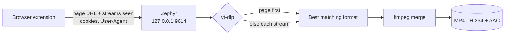

<div align="center">


# Zephyr Download Manager

**Fast, resumable downloads and one-click video grabbing for Windows.**
Multi-connection engine · queues & scheduler · browser integration · powered by yt-dlp


-41CD52?style=flat-square)


[Features](#-features) · [Install](#-install) · [Browser extension](#-browser-extension) · [Video downloads](#-video-downloads) · [Build](#-build-from-source) · [Settings](#-settings) · [Troubleshooting](#-troubleshooting)

</div>

---

## ✨ Features

| | |
|---|---|
| **Multi-connection engine** | Splits each file into up to 32 live segments and re-splits the biggest remaining one so every connection stays busy. Resumes after pauses, crashes and restarts. |
| **Parallel downloads** | Every download runs on its own thread. A global limit (default 5) keeps servers happy; extra downloads wait as *Queued* and start automatically. |
| **Queues & scheduler** | Start/stop times, chosen weekdays, per-queue limits, and *close Zephyr* or *shut down the PC* when everything finishes. |
| **Video grabbing** | Paste a page link or click the extension button. yt-dlp finds the video, ffmpeg merges video and audio, and the result is MP4 (H.264 + AAC) so it plays in Windows Movies & TV. |
| **Browser extension** | Chrome, Edge, Brave, Vivaldi and Firefox. Catches downloads, detects playing videos, adds a right-click menu, and forwards your login session when a site needs it. |
| **Site Grabber** | Explore a site up to 4 levels deep, filter by file type (images, ZIPs, PDFs, videos…), tick what you want and add it all to the queue. |
| **Smart naming** | Real file names from server headers and file types — never a mystery file called `download`. Web pages and expired links are rejected instead of saved as broken files. |
| **Categories** | Compressed, Documents, Music, Programs, Video — each with its own folder. |
| **Convenience** | Clipboard link monitor, batch add from clipboard, tray icon, start minimized with Windows, “Send to” menu, speed limiter, proxy, HTTP authentication, optional antivirus scan after download. |
| **Installer with guide** | A normal Windows installer (Start menu, uninstaller, optional desktop icon and startup) that finishes by opening a step-by-step guide for the browser extension. |

---

## 📦 Install

### For users

1. Run **`Zephyr-Setup.exe`** and follow the wizard. Python is **not** required.
2. On the last page keep the boxes ticked:
   - **Open the installation guide** – step-by-step help for adding the extension by hand.
   - **Add the Zephyr extension to my browsers** – a helper that opens each browser for you and pastes the folder path.
3. In each browser: turn on **Developer mode** → **Load unpacked** → the helper does the rest.

> The guide is always available later at **Start menu → Zephyr Download Manager → Installation guide**.

### Requirements

| | Needed for | Details |
|---|---|---|
| Windows 10 / 11, 64-bit | Running Zephyr | Nothing else to install |
| Python 3.12 or 3.13 | *Building* the `.exe` | Tick **Add Python to PATH** |
| Inno Setup 6 | *Building* the installer | Free: <https://jrsoftware.org/isdl.php> |
| Internet (first build only) | *Building* | Downloads yt-dlp, ffmpeg and Deno |

---

## 🧩 Browser extension

The extension talks to the running Zephyr app over `127.0.0.1:9614`. If Zephyr is closed, the browser simply keeps its own download.

| Mode | How it works | Clicks |
|---|---|---|
| **Guided** *(default)* | `Zephyr-Setup.exe` opens each installed browser on its extensions page; you enable Developer mode and click *Load unpacked*. | 2 per browser |
| **Forced, all browsers** | After the extension is published to the Chrome Web Store / Edge Add-ons, add its ID to `installer\setup.iss`. The installer then sets a machine-wide policy: silent install for **every user and profile** in Chrome, Edge and Brave. | 0 |

Why can’t it be fully silent without the stores? Chrome and Edge do not allow a local folder or `.crx` to be pre-installed on normal PCs. Details and the exact steps are in [`installer/README.md`](installer/README.md).

**Using it**

- **Downloads** – files matching your capture list are sent to Zephyr automatically.
- **Videos** – hover a playing video and click **⬇ Download with Zephyr**, or open the toolbar icon and choose **Grab video from this page**.
- **Links** – right-click → **Download with Zephyr**.

**Firefox:** copy `browser-extension\manifest.firefox.json` over `manifest.json`, open `about:debugging#/runtime/this-firefox` → *Load Temporary Add-on*. (Permanent installs need a Mozilla-signed add-on.)

---

## 🎬 Video downloads



- **Page first, streams as backup.** The extension never offers stream fragments (`.ts`, `.m4s`, `videoplayback` chunks), which would save an unplayable file.
- **Format choice.** H.264 + AAC is tried first, then any format, then a plain “best”. Without ffmpeg, only single-file formats are chosen.
- **Your session.** Browser cookies, the browser’s User-Agent, the Referer and HTTP credentials are passed to yt-dlp, so logged-in content works.
- **Clear errors.** Missing ffmpeg, login required, DRM, rate limits, unsupported pages and network problems each get a plain-language message.
- **YouTube** needs a JavaScript engine for yt-dlp. Zephyr ships **Deno** (and the yt-dlp EJS component) for this.
- **Quality cap:** *Options → Video → Max video height* (`0` = best).

`ffmpeg.exe` and `deno.exe` live in the **`runtime`** folder next to `Zephyr.exe`; `build_exe.bat` puts them there.

---

## 🛠 Build from source

```text
BUILD_ALL.bat            ← double-click: builds everything
├─ build_exe.bat         →  release\Zephyr.exe  (+ release\runtime\ffmpeg.exe, deno.exe)
└─ installer\build_installer.bat  →  installer\Output\Zephyr-Setup.exe
```

1. Install **Python 3.12/3.13** (Add to PATH) and **Inno Setup 6**.
2. Double-click **`BUILD_ALL.bat`**. The first run creates a private `.venv`, installs dependencies and builds both files.
3. Share `installer\Output\Zephyr-Setup.exe`, or the portable `release\` folder (keep `runtime\` next to `Zephyr.exe`).

**Run from source (no build):**

```bash
pip install PySide6 requests "yt-dlp[default]" imageio-ffmpeg
python pydm.py
```

Re-run `build_exe.bat` now and then: it upgrades yt-dlp, and video sites change often.

### Project layout

```text
pydm.py                    application (UI, download engine, queue manager, local server)
zephyr_helpers.py          naming, format selection, cookies, ffmpeg lookup, error messages
browser-extension/         Manifest V3 extension (Chrome / Edge / Brave / Firefox)
installer/                 Inno Setup script, install guide, extension helper
store/                     ready-to-upload zip for the extension stores
build_exe.bat · BUILD_ALL.bat
```

---

## 🔧 Settings

Open **Downloads → Options**. Settings are stored in `%USERPROFILE%\.zephyrdm\config.json`; the download list is `downloads.json` in the same folder.

| Setting | Default | What it does |
|---|---|---|
| Max simultaneous downloads | `5` | Global limit; `0` = unlimited. Extra downloads wait in line. |
| Max connections per file | `8` | 1–32 segments per file. |
| Speed limit (KB/s) | `0` | Global cap; `0` = off. |
| Retries | `6` | Per segment / fragment. |
| Proxy | *(none)* | `http://host:port` |
| User agent | Chrome-style | Used for downloads when the browser doesn’t supply one. |
| Browser port | `9614` | Restart Zephyr after changing; must match the extension. |
| Max video height | `0` | `0` = best, or e.g. `1080`, `720`. |
| Antivirus scan | off | Runs a command (Windows Defender by default) after each download. |
| Default folder | `Downloads\Zephyr` | Category sub-folders are created inside. |

---

## 🔒 Privacy & security

- Zephyr has **no analytics or telemetry**. It connects only to the addresses you download from.
- The browser bridge listens on **`127.0.0.1` only** (not reachable from other computers). Any web page in your browser could ask it to open an *Add download* window, but **nothing downloads until you confirm**.
- Login cookies sent by the extension are used only to fetch that video or file. Like the rest of the download list, they are stored locally in `downloads.json`.
- Windows SmartScreen will warn about an unsigned `.exe` until it is signed with a code-signing certificate and builds download reputation.

---

## 🩺 Troubleshooting

<details>
<summary><b>“You have requested merging of multiple formats but ffmpeg is not installed”</b></summary>

`ffmpeg.exe` must be in the `runtime` folder next to `Zephyr.exe`. Rebuild with `build_exe.bat` (it adds it), or reinstall with the new installer.
</details>

<details>
<summary><b>YouTube shows “Requested format is not available”</b></summary>

YouTube needs a JavaScript engine. Check that `runtime\deno.exe` exists (the build downloads it) and rebuild with the latest yt-dlp.
</details>

<details>
<summary><b>Windows error 0xC00D36E5 when opening a video</b></summary>

The file is not a playable video — usually an unmerged stream, a web page saved as a video, or a codec Windows can’t play. Zephyr now prefers MP4 (H.264 + AAC) and rejects partial files. If a site only offers VP9/AV1, play it in VLC.
</details>

<details>
<summary><b>A file named “download” with no extension</b></summary>

Fixed: names now come from the server’s headers and content type. If the server returns a web page instead (expired link, login needed), Zephyr reports it instead of saving it.
</details>

<details>
<summary><b>The extension doesn’t catch downloads</b></summary>

Make sure Zephyr is running (tray icon), the extension is enabled, and the port in *Options* is `9614`. Open **Start menu → Zephyr Download Manager → Installation guide** for the full steps.
</details>

<details>
<summary><b>Several downloads fail when started together</b></summary>

Some servers limit connections per visitor. Lower *Max simultaneous downloads* or *Max connections per file*.
</details>

---

## 🚧 Known limits

- DRM-protected video (Netflix, Disney+, …) cannot be downloaded.
- Site coverage for video follows yt-dlp.
- Chrome/Edge cannot silently install a local extension; Firefox needs a signed add-on for permanent installs.

---

## 🙏 Third-party software

| Component | Purpose | License |
|---|---|---|
| [yt-dlp](https://github.com/yt-dlp/yt-dlp) + yt-dlp-ejs | Video extraction | Unlicense |
| [FFmpeg](https://ffmpeg.org) (via imageio-ffmpeg) | Merging video and audio | LGPL / GPL, depends on the build |
| [Deno](https://deno.com) | JavaScript runtime for YouTube | MIT |
| [PySide6 / Qt](https://doc.qt.io/qtforpython-6/) | User interface | LGPL-3.0 |
| [Requests](https://requests.readthedocs.io) | HTTP | Apache-2.0 |
| [Inno Setup](https://jrsoftware.org/isinfo.php) | Installer | Inno Setup License |

If you distribute Zephyr, check that the license terms of the bundled FFmpeg build fit how you share it.
